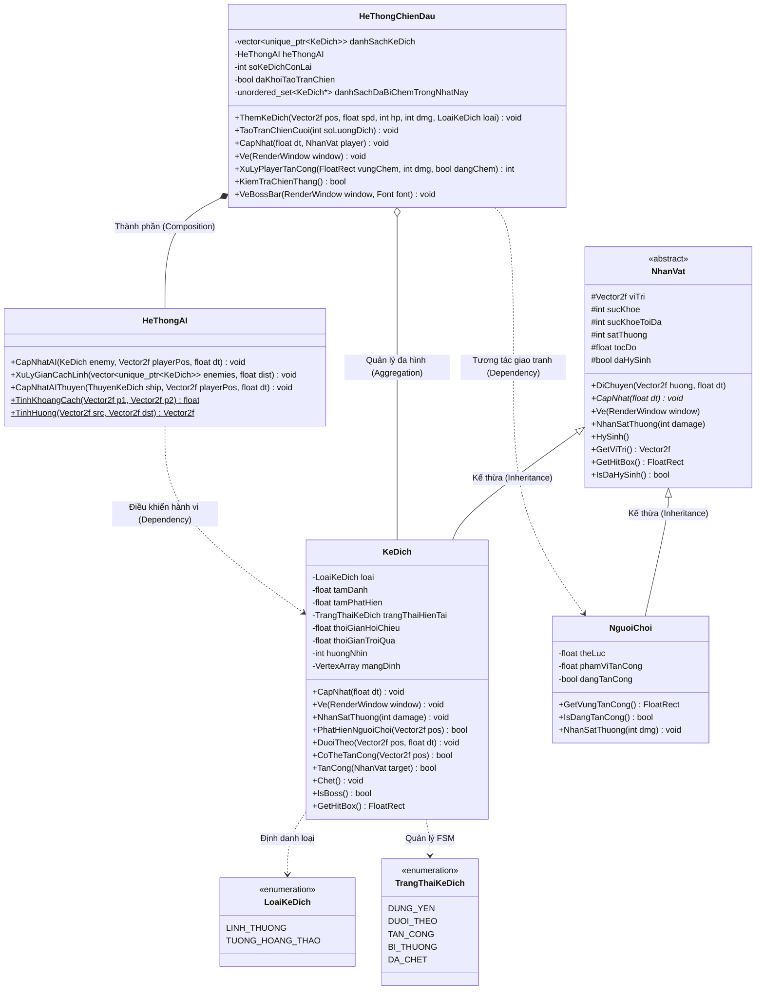

# KỊCH BẢN QUAY VIDEO GIẢI THÍCH CODE & PROJECT (2 - 3 PHÚT)
**Học phần:** Lập trình hướng đối tượng (C++17 / SFML)  
**Dự án:** Game Lịch Sử *Bạch Đằng 938*  
**Sinh viên trình bày:** Nguyễn Minh Nhân  
**Phân hệ phụ trách:** Kẻ địch (`KeDich`), Trí tuệ nhân tạo (`HeThongAI`) & Hệ thống chiến đấu (`HeThongChienDau`)  

> 💡 **HƯỚNG DẪN QUAY:** Bạn chỉ cần bật phần mềm quay màn hình (OBS, Windows Game Bar hoặc Bandicam), mở sẵn VS Code / Visual Studio, vừa nói vừa bấm chuột theo các chỉ dẫn `🎬 [Thao tác màn hình]` bên dưới.

---

## 🎙️ LỜI THOẠI QUAY VIDEO (VĂN NÓI ĐỌC TRỰC TIẾP)

### ⏱️ Đoạn 1: Mở đầu & Giới thiệu phân hệ (0:00 – 0:20)
* 🎬 **[Thao tác màn hình]:** Mở cây thư mục project, trỏ chuột vào 2 thư mục `NhanVat` và `ChienDau`.
* 🎙️ **Lời đọc:**  
  *"Dạ em chào Thầy! Em là Minh Nhân. Trong đồ án game lịch sử Bạch Đằng 938, em đảm nhận phân hệ Kẻ địch, Trí tuệ nhân tạo (AI) và Hệ thống chiến đấu. Trong video này, em xin phép đi thẳng vào việc em đã vận dụng 4 trụ cột của Lập trình hướng đối tượng OOP vào từng file mã nguồn của mình như thế nào ạ."*

---

### ⏱️ Đoạn 2: Tính Kế Thừa & Trừu Tượng (0:20 – 0:55)
* 🎬 **[Thao tác màn hình]:** Mở file `NhanVat/NhanVat.h`, cuộn đến hàm thuần ảo `CapNhat() = 0`, sau đó chuyển tab sang `NhanVat/KeDich.h`.
* 🎙️ **Lời đọc:**  
  *"Đầu tiên là **Tính Kế thừa và Trừu tượng**. Ở đây, lớp cha `NhanVat` là một Abstract Class với phương thức thuần ảo `CapNhat() = 0`. Lớp `KeDich` của em kế thừa công khai từ `NhanVat`.  
  Nhờ kế thừa, `KeDich` tái sử dụng hoàn toàn các thuộc tính chung của một thực thể sống như tọa độ `viTri`, lượng máu, tốc độ và cờ hy sinh mà không bị lặp code. Đồng thời, em mở rộng các thuộc tính đặc thù của giặc như tầm phát hiện, tầm đánh, thời gian hồi chiêu và phân cấp chủng loại gồm lính thường và Chủ tướng Lưu Hoằng Thao."*

---

### ⏱️ Đoạn 3: Tính Đóng Gói & Toán học AI (Euclid) (0:55 – 1:40)
* 🎬 **[Thao tác màn hình]:** Mở file `ChienDau/HeThongAI.h` và `ChienDau/HeThongAI.cpp`, trỏ chuột vào hàm `TinhKhoangCach` và `TinhHuong`.
* 🎙️ **Lời đọc:**  
  *"Thứ hai là **Tính Đóng gói**. Toàn bộ trạng thái FSM nội tại và các bộ đếm hồi chiêu của địch đều được để `private`, bên ngoài chỉ có thể tương tác qua các hàm getter/setter có kiểm soát.  
  Đặc biệt, em tách riêng bộ não `HeThongAI` theo nguyên lý Đơn trách nhiệm (Single Responsibility). Toàn bộ thuật toán hình học vector được em đóng gói thành các hàm static tiện ích:  
  Ví dụ hàm `TinhKhoangCach`, em áp dụng công thức khoảng cách Euclid giữa người chơi và địch để kích hoạt trạng thái rượt đuổi hay tấn công. Còn hàm `TinhHuong` là công thức chuẩn hóa vector đơn vị, giúp quân giặc luôn di chuyển mượt mà ở đúng vận tốc 120 pixel/giây mà không bị giật hay bay quá tốc độ."*

---

### ⏱️ Đoạn 4: Tính Đa Hình & Quản lý bộ nhớ (1:40 – 2:20)
* 🎬 **[Thao tác màn hình]:** Mở file `ChienDau/HeThongChienDau.h`, trỏ vào dòng `std::vector<std::unique_ptr<KeDich>> danhSachKeDich`.
* 🎙️ **Lời đọc:**  
  *"Thứ ba là **Tính Đa hình lúc chạy (Runtime Polymorphism)**. Trong lớp `KeDich`, em ghi đè các hàm ảo `CapNhat()`, `Ve()` và `NhanSatThuong()`. Khi trúng đòn, `KeDich` tự xử lý hiệu ứng nháy trắng và kiểm tra máu.  
  Sang lớp `HeThongChienDau`, em quản lý toàn bộ quân giặc trên chiến trường thông qua danh sách con trỏ đa hình: `std::vector<std::unique_ptr<KeDich>>`. Vòng lặp game chỉ cần duyệt danh sách này và gọi các phương thức ảo. Việc dùng con trỏ thông minh `unique_ptr` giúp tự động gọi đúng hàm hủy của lớp con và giải phóng sạch bộ nhớ ngay khi địch ngã xuống, tránh hoàn toàn lỗi rò rỉ bộ nhớ."*

---

### ⏱️ Đoạn 5: Demo ngắn & Kết thúc (2:20 – 2:50)
* 🎬 **[Thao tác màn hình]:** F5 chạy game demo cảnh lính chạy đuổi theo chém người chơi (khoảng 15 giây), sau đó chuyển về sơ đồ UML.
* 🎙️ **Lời đọc:**  
  *"Về mặt logic chiến đấu: AI địch hoạt động theo Máy trạng thái FSM 5 bước: Đứng yên, Đuổi theo, Tấn công, Bị thương và Đã chết. Em còn xử lý thuật toán tách lính (Flocking) để giặc tự giãn khoảng cách không bị đè hình lên nhau, và dùng `std::unordered_set` để mỗi nhát chém chỉ gây sát thương đúng một lần cho mỗi tên địch.  
  Đó là toàn bộ phần kiến trúc hướng đối tượng và mã nguồn trong phân hệ của em. Em cảm ơn Thầy đã theo dõi video ạ!"*

---

## 📊 SƠ ĐỒ LỚP UML (CLASS DIAGRAM - MERMAID)

